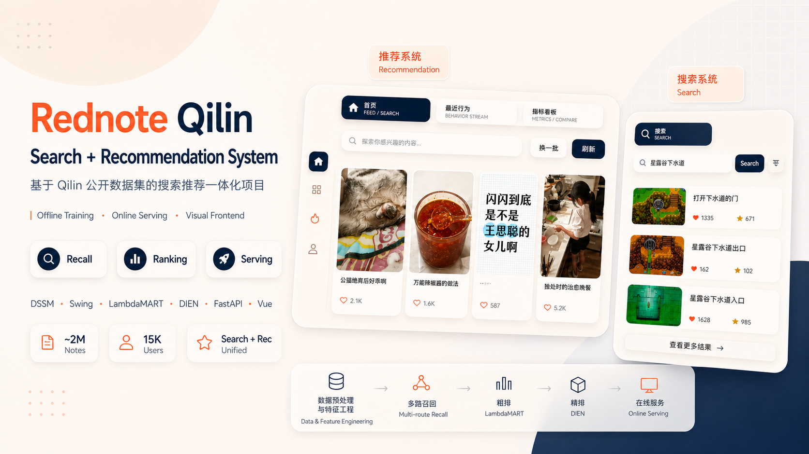
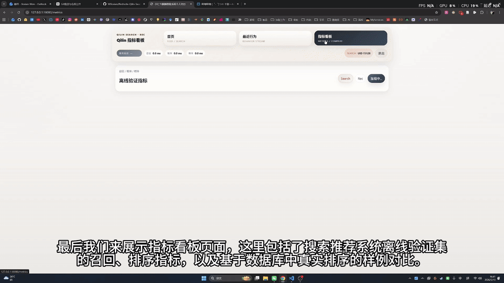

<div align="center">

[](./README.md)
[](./README_EN.md)

</div>
# Rednote Qilin Search & Recommendation Personal Project



Qilin is a personal project for an integrated **search + recommendation** system inspired by real-world large-scale industry stacks for Rednote (Xiaohongshu)-style content platforms.

It is built around three layers:
- **Offline layer**: sample construction, feature generation, recall / preranking / ranking training, index building, artifact deployment
- **Online layer**: FastAPI serving, cold start handling, recall, multi-route fusion, preranking, ranking, real-time behavior write-back
- **Frontend layer**: Vue + Vite UI covering feed, detail page, behavior stream, and metrics dashboard

The project goal is not to collect isolated model scripts, but to connect the full loop of **offline training → online deployment → UI verification → metrics replay**.

**Demo videos:**  
- Bilibili: https://www.bilibili.com/video/BV1dDLm6qE9J/?share_source=copy_web&vd_source=e4fa524ab04ebed66f21b030503dfaaa  
- Xiaohongshu: https://www.xiaohongshu.com/explore/6a0d9df4000000003601c261?xsec_token=ABI5i6pPu-UkLbTQU14r4d7DGhMIrTiy-cbBKXE5coV1s=&xsec_source=pc_user

**Reference machine:** GPU: 5070 Ti 32GB VRAM, CPU: 9700X (8 cores), RAM: 32GB, SSD: ~500GB.

## 0. Overview and Results

### 0.1 Overview

Qilin is organized around the common serving path of **data preprocessing → feature engineering → recall → preranking → ranking → online serving**.

- Data scale
  - Notes: `1,983,938 (~2M)`
  - Users: `15,482`
- Search dataset
  - Training set: `44,024`
  - Test set: `6,192`
  - Features: rich query metadata, user interaction logs, clicked-label ground truth
- Recommendation dataset
  - Training set: `83,437`
  - Test set: `11,115`
  - Features: detailed user behavior sequences, candidate note pools, contextual features, clicked-label ground truth

### 0.2 Results

- Online service (local sequential fresh-inference HTTP)
  - WSL2, Ryzen 7 9700X (8 vCPUs), RTX 5070 Ti 16GB; one worker, four compute threads, 20 items per page. Each scene received 32 warmups followed by 200 sequential requests with no feed/stage cache hits. Client timings include the complete HTTP response and JSON decoding, excluding image downloads.

  | Scene | P50 | P95 | P99 | HTTP error rate |
  | --- | ---: | ---: | ---: | ---: |
  | Search | 223.6ms | 496.6ms | 654.8ms | 0/200 (0%) |
  | Recommendation | 228.9ms | 369.4ms | 425.1ms | 0/200 (0%) |

  - The GPU was shared. Recommendation currently runs recall only, excluding disabled learned pre-ranking/ranking. These are local measurements of the current version, not a production SLO.

- Search offline metrics
  - Full-catalog pipeline (1,983,938 notes; all 6,192 test requests; known clicks): **HitRate@10 = 55.23%**, **Recall@100 = 63.71%**, MRR@100 = 0.2905.
  - Ranking over all 128,191 original test impressions: **NDCG@10 = 0.5468**, AUC = 0.5813, GAUC = 0.5671.
- Recommendation offline metrics
  - Ranking over all 182,567 original test impressions: **NDCG@10 = 0.6195**, AUC = 0.6143, GAUC = 0.6211; this is a logged-impression offline diagnostic.
  - DSSM recall optimization (1,983,938 notes; all 11,893 internal validation requests): aligning the training objective with retrieval scores improved **HitRate@50 by 3.94%** and **Recall@100 by 4.19%**, relative to the K3 content-objective control using the same training set, negative pools, and 327 optimizer updates. Both paired user-cluster 95% confidence intervals were positive.
  - These recall gains apply only to DSSM-only internal validation and are not deployed; they are not three-route fusion or end-to-end gains. Logged-impression ranking is evaluated separately and does not describe the current online Recommendation pipeline.

<details>
<summary>Full-catalog known-click metrics on the complete test sets</summary>

- Search (6,192 test requests): HitRate@10 = 0.5523, Recall@100 = 0.6371, MRR@100 = 0.2905, known_positive_NDCG@10 = 0.2225.
- Recommendation (11,115 test requests): HitRate@50 = 0.0661, Recall@100 = 0.0410, known_positive_NDCG@10 = 0.0049.
- Full-catalog and logged-impression evaluations have different candidate scopes. Missed requests remain included, and Recall uses each request's original clicked-positive count as its denominator. The [shared metrics snapshot](src/backend/online/full_test_metrics.json) is the source of truth for test results.

</details>

### 0.3 Pipeline

```text
Data preprocessing / feature engineering
  → recall training and index building
    → DSSM dual-tower
    → Swing
    → UserCF
    → Faiss IVFPQ
    → multi-route fusion
  → preranking training
    → LambdaMART (LightGBM + XGBoost)
  → ranking training
    → DIEN
  → deployment artifacts
  → FastAPI online serving
  → Vue frontend verification and metrics dashboard
```

## 1. Visual Showcase

### 1.1 Recommendation System Demo

<p align="center">
  
</p>

### 1.2 Search System Demo

<p align="center">
  
</p>

### 1.3 Offline Metrics Dashboard

<p align="center">
  
</p>

### 1.4 Example Comparison Demo

<p align="center">
  
</p>

## 2. Project Structure

### 2.1 Root Layout

```text
Qilin/
├─ datasets/
├─ features/
├─ embeddings/
├─ gif/
├─ image/
├─ outputs/
├─ src/
├─ start.sh
├─ stop.sh
└─ README.md
```

### 2.2 Backend / Training Layout

```text
src/
├─ backend/
├─ preprocess/
├─ recall/
├─ training/
└─ frontend/
```

## 3. System Architecture

### 3.1 Offline Training

```bash
uv run python src/backend/offline/pipeline.py --scene search
uv run python src/backend/offline/pipeline.py --scene rec
```

Main stages:
- `data`
- `feature`
- `training`
- `deploy`
- `feature-upload`

### 3.2 Online Serving

```bash
uv run python src/backend/online/api/main.py
```

The unified online orchestration lives in `src/backend/online/pipeline.py`, covering context parsing, cold start, recall, preranking, ranking, reranking, and final feed/detail response.

### 3.3 Frontend Interaction

The frontend calls backend APIs via `src/frontend/src/services/api.ts` and covers the feed, detail page, behavior stream, and metrics dashboard.

## 4. Models

### 4.1 Recall

- DSSM ANN
- Swing
- UserCF
- Search-specific lexical / semantic request-level fusion

### 4.2 Preranking

GBDT-based preranking compresses the recall pool and uses fast query / user / note / linkage features.

### 4.3 Ranking

DIEN performs finer user-interest modeling on top of preranking candidates.

## 5. Redis in This Project

### 5.1 What Redis Does

Redis is used as the real-time online state layer rather than a place to store offline model files.

### 5.2 What Gets Stored

- user profiles
- recent requests
- history notes
- behavior streams
- exposed notes
- runtime request ids
- deduplication keys

### 5.3 Behavior Write Path

Frontend behavior calls flow through `api.ts` → `main.py` → `pipeline.py` → `realtime_cache.py` and are finally persisted into Redis.

## 6. Deployment Artifacts and Dashboard Snapshots

Online serving loads:

```text
outputs/deploy/{scene}/{tag}/models
outputs/deploy/{scene}/{tag}/index
```

Metrics dashboard snapshots are read from:

```text
outputs/serving_cache/{scene}/{tag}/
```

## 7. GitHub Star History

[](https://star-history.com/#WBoxian/Rednote-Qilin-Search-Rec-System&Date)


